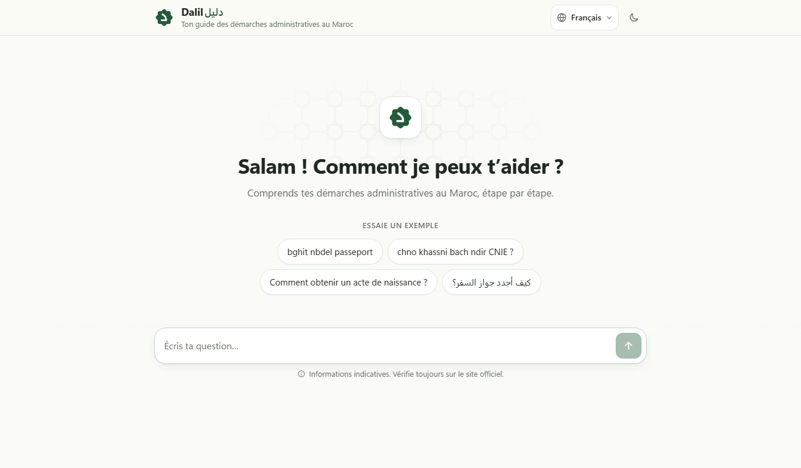
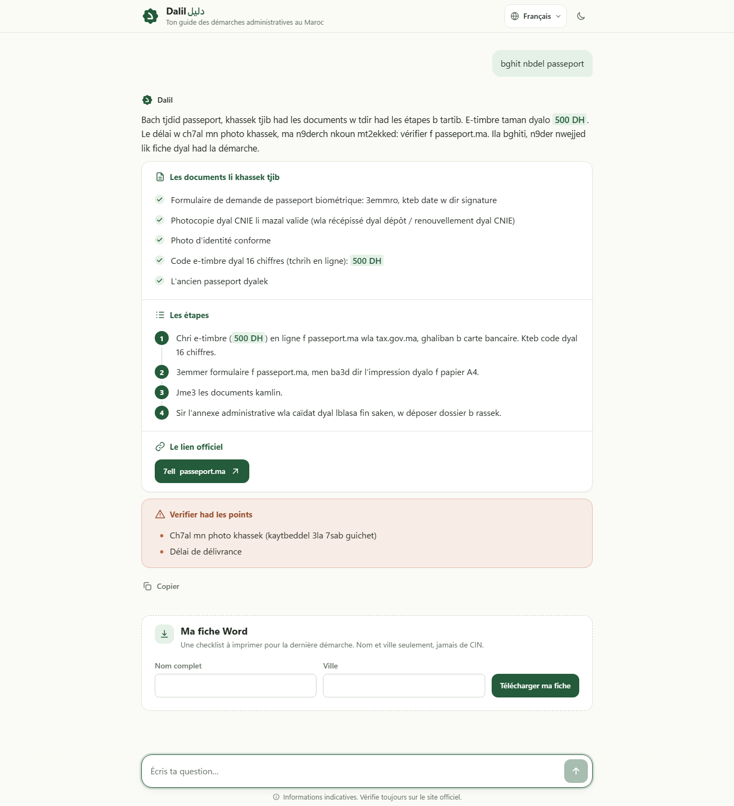
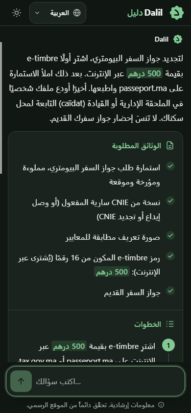
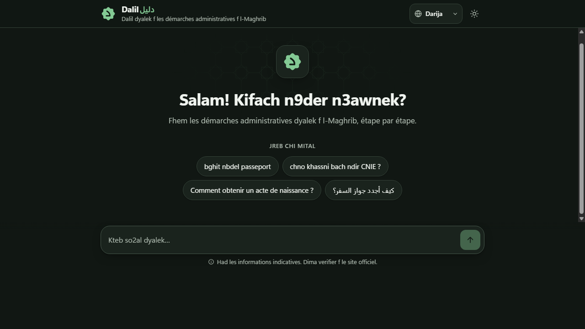

# Dalil · دليل

**Your guide to administrative procedures in Morocco, in Darija, French, Arabic or English.**

Dalil is a conversational assistant that explains Moroccan administrative procedures step by step: which documents to bring, what to do in which order, how much it costs when that is known, and where to find the official website. It can also produce a printable Word checklist for the procedure.

> ⚠️ Dalil is **not an official government service**. The information is indicative: always check the latest requirements on the official websites.



## Features

- **Ask in your own language.** Darija (Latin or Arabic script), French, Modern Standard Arabic or English. Dalil answers in the language of the question.
- **Structured answers.** A short explanation, documents to prepare, numbered steps, the official link, and a separate "to verify" list for anything that is not confirmed.
- **No invented information.** Answers only use the data in [`backend/demarches.json`](backend/demarches.json). If something is missing, Dalil says it is not sure and points to the official website.
- **Clarifying questions.** If a request is ambiguous (for example, a CNIE without knowing whether it is a first application or a renewal), Dalil asks one short question first.
- **Word checklist.** Generates a `.docx` with your name, your city, the documents as checkboxes, the steps and the official link. Dalil never asks for an ID number, password or bank card.
- **Interface in 4 languages, right-to-left support for Arabic, light and dark themes**, and a layout that works on phones, tablets and desktops.

| Answer | Mobile, Arabic (RTL) | Dark theme |
|---|---|---|
|  |  |  |

## Procedures covered

| Procedure | Official website |
|---|---|
| Biometric passport (adults, in Morocco) | passeport.ma |
| CNIE (national electronic ID card): first application, renewal, loss/theft, minors | cnie.ma |
| Full copy of a birth certificate | watiqa.ma |
| CNSS certificates for employees (affiliation, work, salary...) | cnss.ma |
| Certificate of residence (chahada sokna) | wraqi.ma |

Other procedures are not covered yet: Dalil says so instead of guessing.

## Try these questions

- `bghit nbdel passeport`
- `chno khassni bach ndir CNIE ?`
- `Comment obtenir un acte de naissance ?`
- `كيف أجدد جواز السفر؟`

## How it works

```
Angular (frontend)  ──/api──▶  Express (backend)  ──▶  Claude API
                                     │
                     system-prompt.md + demarches.json
```

- **Frontend** (`frontend/`): Angular 21, standalone components, no UI library.
- **Backend** (`backend/`): Node.js + Express. It sends the system prompt and the procedures database to Claude, keeps the conversation history sent by the frontend, checks that the reply is valid JSON, and generates the Word file with [`docx`](https://www.npmjs.com/package/docx).
- **Model**: `claude-opus-5-5` via the [Anthropic SDK](https://www.npmjs.com/package/@anthropic-ai/sdk).

| File | Role |
|---|---|
| `backend/demarches.json` | Procedures database: the single source of truth |
| `backend/system-prompt.md` | Assistant instructions (only the text below the first `---` line is sent) |
| `backend/fiche-word-modele.md` | Layout of the Word checklist |
| `backend/server.js` | `POST /chat` and `POST /fiche` routes |

## Run it locally

**Requirements:** Node.js 22+ and an [Anthropic API key](https://console.anthropic.com/).

1. **Backend**

   ```bash
   cd backend
   npm install
   ```

   Create `backend/.env`:

   ```
   ANTHROPIC_API_KEY=your-key-here
   ```

   Then start it (port 3000):

   ```bash
   npm start
   ```

2. **Frontend** (in a second terminal)

   ```bash
   cd frontend
   npm install
   npm start
   ```

3. Open **http://localhost:4200**. The Angular dev server forwards `/api` to the backend (see `frontend/proxy.conf.json`).

The API key stays in `backend/.env`, which is ignored by Git. It is never sent to the browser.

## Adding or updating a procedure

Edit `backend/demarches.json` and restart the backend: the server checks that the file is valid JSON at startup. Put anything that is not confirmed (fees, delays...) in the procedure's `a_verifier` list so Dalil never presents it as a fact.
